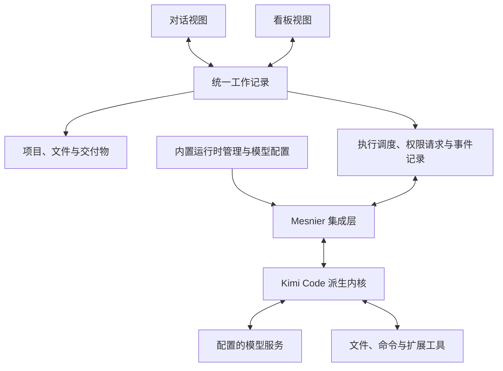

<div align="center">
  

  <h1>Mesnier</h1>

  <p><strong>在对话中探索，在看板中推进。</strong></p>
  <p>面向 Work 与 Coding 的通用 Agent 工作台。</p>
</div>

Mesnier 希望将对话式 Agent 与任务看板放进同一个 APP：你可以直接与 Agent 交流、共同完成工作，也可以把目标交给看板上的 Agent 持续推进，并随时切换视图，接着同一份上下文继续工作。

Mesnier 计划以新版 [Kimi Code](https://github.com/MoonshotAI/kimi-code) 的 TypeScript 源码作为 Agent 底座二次开发，提供由应用内置和管理的 Agent 运行时。产品功能与交互参考 [ZCode](https://github.com/zai-org/ZCode)，看板与任务组织参考 [Multica](https://github.com/multica-ai/multica)。

应用负责工作空间、对话、看板、任务编排、验收与产物管理；派生内核复用并按需扩展 Kimi Code 的模型调用、工具循环、上下文、权限交互和会话能力。首版目标是不要求用户预装 Agent CLI，在应用内完成模型配置后开始工作。

> **项目状态：产品规划阶段，Agent 底座方向已确定。** 当前仓库包含产品说明、品牌素材和 OpenSpec 规划，尚未引入 Kimi Code 源码，也没有可运行的应用。以下功能、平台和兼容性均为建设目标，不代表已经实现或验证通过。当前变更见 [采用 Kimi Code Agent 底座](openspec/changes/adopt-kimi-agent-foundation/proposal.md)。

## 为什么做 Mesnier

有些工作适合边聊边做：分析资料、探索方案、修改代码、处理临时问题。有些工作适合先定义目标，再分配、执行和验收：完成一份报告、推进一个功能、批量处理多个任务。

Mesnier 将这两种方式连接起来，让工作从一次对话自然发展成一个任务，也让任务执行过程中随时可以回到对话。

- **Work 与 Coding 并重**：既处理文档、资料、数据和日常工作，也处理代码、测试和项目交付。
- **两种模式，一份工作记录**：对话、任务、执行过程与交付物保持关联。
- **应用管理自己的 Agent**：基于 Kimi Code 二开，统一运行、权限、会话和错误处理体验。
- **模型与工具按需配置**：在已验证的接口范围内选择模型服务、Agent 配置与工具，逐步扩展 Work 和 Coding 能力。
- **从配置到交付尽量可视化**：在应用中完成模型配置、执行、结果查看和验收。

## 双模式工作

### 对话模式 · Chat

围绕当前目标与 Agent 持续交流，适合探索、即时协作与交互式执行。

- 选择项目、工作目录、Agent 配置和可用模型，发起或继续会话。
- 添加文件与任务背景，查看流式回复、工具调用和执行日志。
- 补充指令、处理权限请求、中止或继续执行；尚未支持的控制操作明确提示。
- 在同一个工作界面查看生成的文档、文件和代码变更。
- 将需要持续跟踪的对话关联到看板任务，保留原有记录。

### 看板模式 · Board

围绕目标与交付物组织工作，适合异步执行、多个任务并行与阶段验收。

- 创建任务，描述目标、上下文、交付物和验收标准。
- 为任务指定 Agent 配置与工作目录，按队列调度执行。
- 通过「待办 → 进行中 → 待验收 → 已完成」跟踪进度；单独标记阻塞、失败和取消。
- 从任务卡片查看关联对话、执行历史、待处理请求和产物。
- 参考 Multica 的状态分列、卡片摘要、Agent 指派、筛选与详情查看；拖拽状态遵守执行和验收规则，启动、取消与验收提供明确操作。
- 首版采用串行队列；后续在能力与资源允许时并行执行独立任务，完成后由用户验收。

### 自由切换的含义

切换模式改变的是工作的呈现方式，不会复制任务，也不会重新发起一次执行。

| 操作 | 目标行为 |
| --- | --- |
| 对话转为任务 | 为现有对话创建或关联任务，沿用上下文和产物引用 |
| 从卡片进入对话 | 打开该任务的关联会话，查看进展并补充需求 |
| 执行中切换视图 | 保持当前执行及其权限请求、状态和日志 |
| 返回看板 | 展示同一任务的最新进度与验收状态 |
| 修改 Agent 或模型配置 | 新配置用于后续执行，当前执行保留启动时的配置记录 |

切换视图、调整卡片位置和创建关联都不应重复发起执行。执行中追加指令、取消和恢复以派生内核实际接入并验证的能力为准；不能执行的操作须说明原因，不能通过界面状态伪装成功。

## Work 与 Coding

| 场景 | 工作示例 | 交付形式 |
| --- | --- | --- |
| Work | 资料整理、调研分析、报告撰写、表格处理、日常工作自动化 | 文档、表格、分析结果及相关文件 |
| Coding | 代码理解、功能开发、问题修复、测试执行、代码审查 | 文件变更、Diff、测试结果及交付说明 |
| 混合工作 | 从需求调研到方案设计，再到开发与交付文档 | 关联同一目标的多种产物 |

Work 任务不要求绑定 Git 仓库。Coding 任务可以关联仓库，并在后续提供 Git worktree 隔离、变更预览与审查能力。首个闭环优先覆盖本地文件和基础文本产物；文档、表格、演示文稿及浏览器等能力按工具依赖和实际验证结果逐步接入，不默认继承参考项目的全部插件能力。

## Agent 底座与二开边界

这里的 **Agent 配置** 包含角色指令、模型与工具设置；**Agent 底座** 是 Kimi Code 的源码基础；**Agent 运行时** 是 Mesnier 基于该源码维护和分发的执行组件；**模型服务** 提供推理能力。选择 Kimi Code 作为底座不等于只能使用 Kimi 模型，其他服务能否接入仍需核对协议、工具调用和模型能力。

### 已确定的分工

| 层次 | 规划职责 |
| --- | --- |
| Mesnier 产品层 | 工作空间、Chat / Board、任务、调度、验收、交付物与用户设置 |
| Mesnier 集成层 | 管理派生运行时和版本，将会话、流式事件、权限、追加指令、取消与恢复接入产品 |
| Kimi Code 派生内核 | 复用并按需扩展执行循环、上下文、模型适配、工具调用、权限与会话机制 |
| 模型与工具 | 按配置访问模型服务、本地文件和命令，以及后续接入的 MCP、Skills 和专用工具 |

采用新版 `MoonshotAI/kimi-code`，不以已归档的 Python `kimi-cli` 作为新底座。优先围绕其 SDK、会话与事件接口建立 Mesnier 自己的集成边界；源码如何纳入、执行组件如何分发，以及采用何种进程通信方式，在工程初始化前通过验证确定。

二开保留可追溯的上游版本、许可证和补丁记录，优先在集成层、工具扩展和配置层实现差异。升级前验证执行、权限、取消、恢复和数据兼容性，不假定内部 SDK 永远稳定。

### 应用管理运行时与模型配置

目标流程：**安装 Mesnier → 初始化内置运行时 → 配置模型服务并完成认证 → 验证可用 → 选择目录开始工作**。

- **运行时准备**：由应用检查和管理派生运行时，缺少系统依赖时给出明确指引，不要求先手动安装其他 Agent CLI。
- **模型配置**：配置服务、模型和凭据，区分未配置、待认证、可用与异常；上游官方账号或订阅的适用范围需单独确认。
- **独立数据**：Mesnier 使用自己的配置、凭据引用、会话和日志目录，不默认复用或修改用户已有的 Kimi、ZCode 等应用数据。
- **可见的控制**：呈现工具事件、权限请求、取消结果和失败原因；能力未接入或配置不可用时说明限制。
- **维护与诊断**：记录应用、派生内核和上游版本，规划升级、故障诊断与数据恢复策略。

第三方 CLI 适配不纳入首版；以后是否增加由独立变更评估，不承诺不同引擎原生会话或内部状态的无损迁移。

## 产品结构



统一模型包含项目、会话、任务、执行记录和产物：一个任务可以关联多次执行，每次执行记录内核版本、Agent 与模型配置快照、工作目录、状态、事件及产物；凭据只记录引用。Mesnier 保存产品事实，并通过明确关联使用内核会话，不让 Chat 与 Board 分别维护一份执行状态。任务是否通过验收，与某一次执行是否成功结束分别记录。

初期优先验证本地桌面体验，目标平台为 macOS、Windows 和 Linux；远程执行主机与 Web 入口留作后续扩展。Agent 源码基础已选定，桌面框架、宿主实现、通信方式和持久化方案仍待工程选型，不直接沿用参考项目的完整技术栈。

## 建设路线

### 01 · 底座接入与最小工作闭环

- [ ] 固定 Kimi Code 上游基线，确定源码集成、许可证保留、构建与应用分发方式。
- [ ] 使用隔离配置验证模型调用、工具执行、权限拒绝、取消和会话恢复，确定工程方案。
- [ ] 工作空间、项目与本地目录管理。
- [ ] 内置派生运行时、模型配置及认证引导。
- [ ] 对话执行、流式事件、权限交互与产物记录。
- [ ] 基础看板与任务生命周期。
- [ ] 同一任务在对话和看板间切换，保持执行与上下文关联。
- [ ] 本地持久化，以及重启后的历史读取和执行状态核对。

### 02 · 完善 Work 与 Coding 体验

- [ ] 更多模型服务与目标平台兼容验证。
- [ ] 参考 ZCode 扩展文档、表格、演示文稿等产物的生成、预览与管理。
- [ ] 按独立验证接入 MCP、Skills、浏览器及其他工作工具。
- [ ] Git 变更查看、worktree 隔离与验收流程。
- [ ] 并发调度、目录隔离，以及更丰富的看板筛选与卡片交互。

### 03 · 扩展协作与执行环境

- [ ] 远程执行主机。
- [ ] 可复用的任务模板与工作流程。
- [ ] 多 Agent 协作与定时任务。

首个可用版本的验收目标：在未预装 Agent CLI 的环境中，通过 Mesnier 配置模型并启动内置运行时；分别完成一个普通目录中的 Work 文件任务和一个 Coding 修改任务。对话可关联为看板任务，切换视图保持同一执行、权限请求和产物关系；执行结束后由用户验收。权限拒绝、取消、失败及应用重启后的状态核对均需有验证记录。

第一阶段的拟实施范围见 [OpenSpec 提案](openspec/changes/adopt-kimi-agent-foundation/proposal.md)、[设计](openspec/changes/adopt-kimi-agent-foundation/design.md) 和 [任务](openspec/changes/adopt-kimi-agent-foundation/tasks.md)。后续阶段仍是路线图，不自动纳入本次变更。

## 当前仓库

```text
Mesnier/
├── AGENTS.md                  # 项目协作约定
├── LESSONS.md                 # 反复修改与 bug 修复的经验记录
├── README.md
├── .agents/skills/            # OpenSpec 生成的 Codex 技能
├── openspec/
│   ├── config.yaml            # 项目上下文与规格编写规则
│   ├── specs/                 # 归档后的能力规格（当前为空）
│   └── changes/
│       └── adopt-kimi-agent-foundation/ # 底座与首个工作闭环的规划，尚未实施
└── assets/
    └── brand/
        ├── mesnier-logo.png    # 透明背景的初版 Logo
        └── logo-prompt.txt     # Logo 生成方式与提示词
```

目前没有应用启动、构建或安装命令；后续随工程初始化补充。

Logo 以字母 **M** 为主体，将对话气泡与看板卡片融入同一个折叠形态，表达两种工作模式的连接。当前素材为 PNG，平台应用图标与其他品牌变体待后续补齐。

## OpenSpec 协作流程

项目使用 [OpenSpec](https://github.com/Fission-AI/OpenSpec) 管理需求、设计和实施任务，采用 `spec-driven` 工作流，已启用 Codex 集成。当前配置由 OpenSpec **1.8.0** 初始化。

在已安装 Node.js 20.19.0 或更新版本的环境中，可安装相同版本的 CLI：

```bash
npm install -g @fission-ai/openspec@1.8.0
```

克隆仓库后即可使用已提交的配置与技能，无需重新初始化。重新打开 Codex 会话后，可使用以下技能：

1. `$openspec-explore`：梳理需求、约束与方案。
2. `$openspec-propose <变更描述>`：生成提案、规格、设计与任务。
3. `$openspec-apply-change <变更名>`：按变更任务实施并验证。
4. `$openspec-archive-change <变更名>`：完成后归档变更并同步能力规格。

需要调整进行中的变更时使用 `$openspec-update-change`；需要在归档前同步规格时使用 `$openspec-sync-specs`。

常用检查命令：

```bash
openspec list
openspec list --specs
openspec validate --all --strict --no-interactive
```

当前有 `adopt-kimi-agent-foundation` 规划变更，`openspec/specs/` 仍为空。严格验证用于检查该变更的规格结构与一致性，不代表应用功能通过验收；能力在实施、验证并归档后才进入 `openspec/specs/`。升级 CLI 后运行 `openspec update`，并检查生成文件的差异。

## 底座与参考来源

| 项目 | 在 Mesnier 中的角色 | 本地研究目录 |
| --- | --- | --- |
| [Kimi Code](https://github.com/MoonshotAI/kimi-code) | Agent 源码底座，维护派生内核及必要扩展 | `/Users/liujialin/project/kimi-code` |
| [ZCode](https://github.com/zai-org/ZCode) | 功能与交互参考：会话、工具事件、权限交互和工作产物 | `/Users/liujialin/project/ZCode` |
| [Multica](https://github.com/multica-ai/multica) | 看板设计参考：状态分列、卡片、Agent 指派与执行历史 | `/Users/liujialin/project/multica` |

本地目录只用于研究，不是 Mesnier 的绝对路径构建依赖；参考快照与具体入口见 [设计依据](openspec/changes/adopt-kimi-agent-foundation/design.md)。当前尚未引入三个项目的代码。后续集成 Kimi Code 源码需保留 MIT 许可与版权声明；如复用其他项目的代码、插件或素材，按对应来源单独核对许可和依赖。Mesnier 自有代码的许可证仍待确定，不把上游官方服务、订阅权益或未公开能力视为自动获得。
