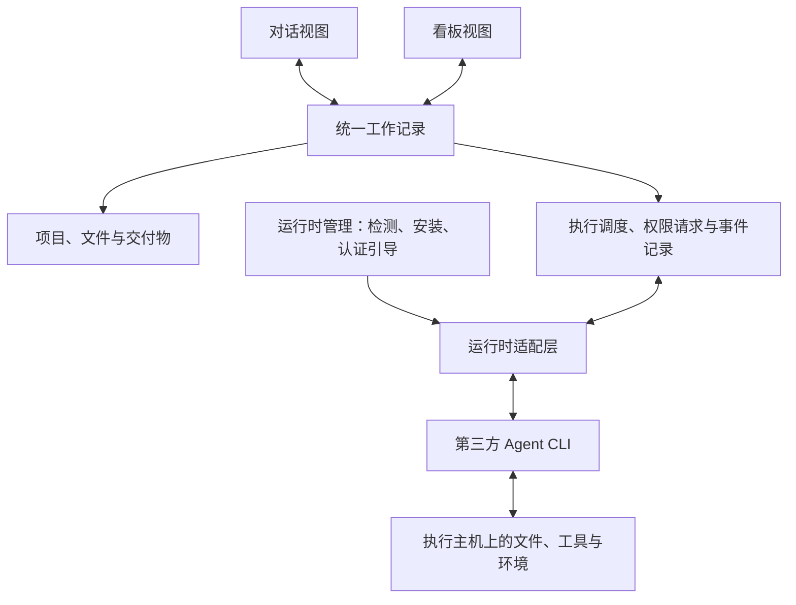

<div align="center">
  

  <h1>Mesnier</h1>

  <p><strong>在对话中探索，在看板中推进。</strong></p>
  <p>面向 Work 与 Coding 的通用 Agent 工作台。</p>
</div>

Mesnier 希望将对话式 Agent 与任务看板放进同一个 APP：你可以直接与 Agent 交流、共同完成工作，也可以把目标交给看板上的 Agent 持续推进，并随时切换视图，接着同一份上下文继续工作。

Mesnier 不自带 Agent CLI。应用负责工作空间、交互、任务编排与结果管理，由用户选择的第三方 Agent 运行时完成实际工作，并提供检测、快捷安装、认证引导与运行管理。

> **项目状态：产品规划阶段。** 当前仓库只有 README 与品牌素材，尚无可运行的应用。以下功能、平台和运行时支持均为建设目标，不代表已经实现或验证兼容。

## 为什么做 Mesnier

有些工作适合边聊边做：分析资料、探索方案、修改代码、处理临时问题。有些工作适合先定义目标，再分配、执行和验收：完成一份报告、推进一个功能、批量处理多个任务。

Mesnier 将这两种方式连接起来，让工作从一次对话自然发展成一个任务，也让任务执行过程中随时可以回到对话。

- **Work 与 Coding 并重**：既处理文档、资料、数据和日常工作，也处理代码、测试和项目交付。
- **两种模式，一份工作记录**：对话、任务、执行过程与交付物保持关联。
- **自由选择运行时**：复用第三方 Agent CLI 及其能力，通过适配层统一接入。
- **从安装到执行尽量可视化**：减少手动配置终端和记忆不同命令的成本。

## 双模式工作

### 对话模式 · Chat

围绕当前目标与 Agent 持续交流，适合探索、即时协作与交互式执行。

- 选择项目、工作目录和 Agent 运行时，发起或继续会话。
- 添加文件与任务背景，查看流式回复、工具调用和执行日志。
- 根据运行时能力补充指令、处理权限请求、中止或继续执行。
- 在同一个工作界面查看生成的文档、文件和代码变更。
- 将需要持续跟踪的对话关联到看板任务，保留原有记录。

### 看板模式 · Board

围绕目标与交付物组织工作，适合异步执行、多个任务并行与阶段验收。

- 创建任务，描述目标、上下文、交付物和验收标准。
- 为任务指定 Agent、运行时与工作目录，按队列调度执行。
- 通过「待办 → 进行中 → 待验收 → 已完成」跟踪进度；单独标记阻塞、失败和取消。
- 从任务卡片查看关联对话、执行历史、待处理请求和产物。
- 在能力与资源允许时并行执行独立任务，完成后由用户验收。

### 自由切换的含义

切换模式改变的是工作的呈现方式，不会复制任务，也不会重新发起一次执行。

| 操作 | 目标行为 |
| --- | --- |
| 对话转为任务 | 为现有对话创建或关联任务，沿用上下文和产物引用 |
| 从卡片进入对话 | 打开该任务的关联会话，查看进展并补充需求 |
| 执行中切换视图 | 保持当前执行及其权限请求、状态和日志 |
| 返回看板 | 展示同一任务的最新进度与验收状态 |
| 为后续执行更换运行时 | 创建新的执行记录，按需传递可移植的任务摘要与文件引用 |

**视图切换与运行时切换是两件事。** 不承诺不同 CLI 的原生会话、隐藏推理状态或工具状态可以无损迁移；不支持实时追加指令的运行时，需要明确提示并在后续执行中处理。

## Work 与 Coding

| 场景 | 工作示例 | 交付形式 |
| --- | --- | --- |
| Work | 资料整理、调研分析、报告撰写、表格处理、日常工作自动化 | 文档、表格、分析结果及相关文件 |
| Coding | 代码理解、功能开发、问题修复、测试执行、代码审查 | 文件变更、Diff、测试结果及交付说明 |
| 混合工作 | 从需求调研到方案设计，再到开发与交付文档 | 关联同一目标的多种产物 |

Work 任务不要求绑定 Git 仓库。Coding 任务可以关联仓库，并在后续提供 Git worktree 隔离、变更预览与审查能力。具体工具、文件格式和外部服务能力取决于所选运行时及其配置。

## 第三方运行时

这里区分三个概念：**Agent** 是承担任务的配置，**Agent 运行时** 是执行工作的第三方 CLI，**执行主机** 是该 CLI 所在的机器。Mesnier 自己的适配器和进程管理组件不负责实现模型推理或 Agent 工具循环。

### 计划接入范围

以下是初始候选清单；接入顺序与最终支持范围以实际适配、官方接口及平台验证结果为准。

| 第三方运行时 | 常见命令 | 规划阶段 |
| --- | --- | --- |
| Claude Code | `claude` | 首批接入 |
| OpenAI Codex CLI | `codex` | 首批接入 |
| OpenCode | `opencode` | 首批接入 |
| Kimi CLI | `kimi` | 后续扩展 |
| GitHub Copilot CLI | `copilot` | 后续扩展 |
| Cursor Agent | `cursor-agent` | 后续扩展 |
| Qwen Code | `qwen` | 后续扩展 |

运行时适配层需要声明各自支持的能力，包括流式输出、会话恢复、工具事件、权限交互、执行中追加消息、取消及用量统计。界面根据能力显示操作，不把所有 CLI 当作完全相同的接口。后续通过扩展适配器接入更多运行时。

### 点击安装与运行时管理

目标流程：**选择运行时 → 检查环境 → 点击安装 → 完成认证 → 验证可用 → 开始工作**。

- **发现已有安装**：检测可执行文件、版本和可用状态，也允许指定自定义路径。
- **快捷安装**：按操作系统与架构选择官方安装渠道，展示来源、目标版本、依赖与安装进度。
- **处理前置条件**：缺少必要依赖时提供安装引导；不支持自动安装的平台明确说明手动步骤。
- **认证引导**：调用运行时支持的登录流程或引导配置凭据；安装完成不等于已经登录可用。
- **安装后验证**：检查命令与版本，验证连接或执行能力，区分已安装、待认证、可用和异常。
- **维护与诊断**：规划版本检查、更新、重试和错误诊断；区分应用安装与用户已有安装，避免覆盖现有环境。

安装程序、登录方式与平台支持会随上游变化，实际实现时以各运行时的官方文档为准。

## 产品结构



统一模型包含项目、会话、任务、执行记录和产物：一个任务可以关联多次执行，每次执行记录具体运行时、工作目录、状态、事件及产物。任务是否通过验收，与某一次进程是否成功退出分别记录。

初期建议优先验证本地桌面体验，目标平台为 macOS、Windows 和 Linux；远程执行主机与 Web 入口留作后续扩展。桌面框架、后端技术和持久化方案尚未确定。

## 建设路线

### 01 · 最小工作闭环

- [ ] 工作空间、项目与本地目录管理。
- [ ] 首批第三方运行时适配、检测、点击安装及认证引导。
- [ ] 对话执行、流式事件、权限交互与产物记录。
- [ ] 基础看板与任务生命周期。
- [ ] 同一任务在对话和看板间切换，保持执行与上下文关联。
- [ ] 本地持久化，以及重启后的历史读取和执行状态核对。

### 02 · 完善 Work 与 Coding 体验

- [ ] 更多运行时与平台兼容验证。
- [ ] 文档和常见工作产物的预览与管理。
- [ ] Git 变更查看、worktree 隔离与验收流程。
- [ ] 并发调度、重试和运行时能力差异提示。

### 03 · 扩展协作与执行环境

- [ ] 远程执行主机。
- [ ] 可复用的任务模板与工作流程。
- [ ] 多 Agent 协作与定时任务。

首个可用版本的验收目标：从应用内安装并配置一个运行时，发起对话，将其关联为看板任务，切换视图继续工作，最终查看并验收交付物，全程保持同一任务的记录关联。

## 当前仓库

```text
Mesnier/
├── README.md
└── assets/
    └── brand/
        ├── mesnier-logo.png    # 透明背景的初版 Logo
        └── logo-prompt.txt     # Logo 生成方式与提示词
```

目前没有应用启动、构建或安装命令；后续随工程初始化补充。

Logo 以字母 **M** 为主体，将对话气泡与看板卡片融入同一个折叠形态，表达两种工作模式的连接。当前素材为 PNG，平台应用图标与其他品牌变体待后续补齐。

## 灵感来源

- [ZCode](https://github.com/zai-org/ZCode)：借鉴对话式 Agent 工作台的交互方向。
- [Multica](https://github.com/multica-ai/multica)：借鉴任务看板、Agent 分配，以及由独立执行组件调用用户已有第三方 CLI 的工作方式。

上述项目是产品设计参考；当前仓库未引入其代码，Mesnier 的技术实现与许可证待后续确定。
