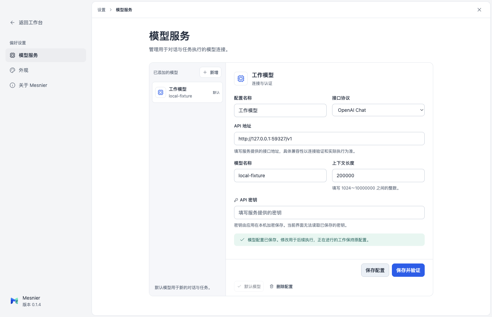
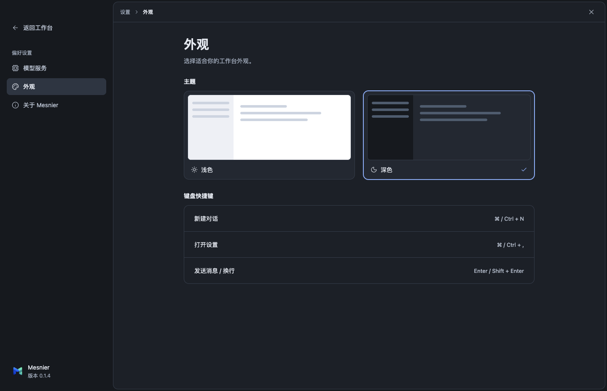
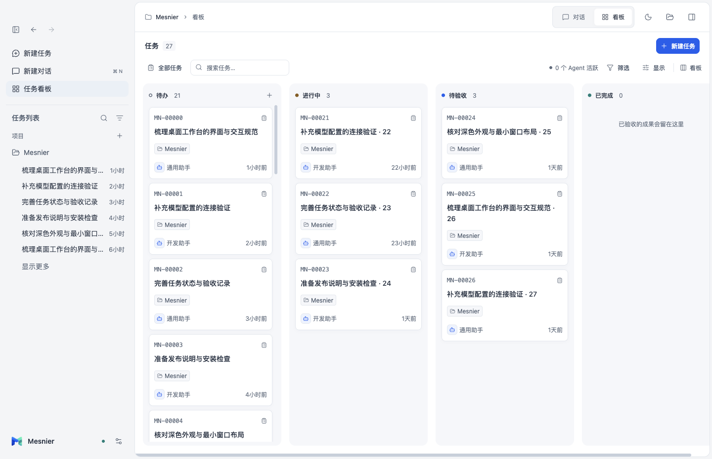

# 设置与看板结构对齐验收

2026-10-23：Mesnier 0.1.4 已安装到 `/Applications/Mesnier.app`，实际启动后核对新版设置和看板，内置 Agent 显示已就绪。应用停留在模型设置页，供用户查看。

## 问题与结果

此前只调整通用样式和侧栏，设置仍是狭长弹窗，看板仍使用短列与宣传标题，未完成逐页参考。现在设置使用全窗口分类导航和模型列表/编辑区；看板使用紧凑工具栏、280px通高列与列内独立滚动。配色仍遵循 Mesnier 蓝青主题。

| 参考区域 | 本次实现 | 实际核对 |
| --- | --- | --- |
| ZCode 设置框架 | 268px分类导航，1000px窗口改为68px图标栏；独立内容框和固定标题 | 1440×930、1000×700截图与几何断言 |
| ZCode 模型服务分栏 | 224px模型列表与编辑区，内容不足时压缩列表；固定保存区 | 新增、选择、编辑、默认、删除与上下文输入 |
| ZCode 外观及分组行 | 两张主题预览卡、可用快捷键、真实版本/运行时/路径 | 深浅主题、分类切换、安装版版本 |
| Multica 看板与列 | 紧凑工具栏，280px列、16px间距、列头固定、各列滚动 | 27张合成卡片、空列同高、滚动互不影响 |
| Multica 卡片信息 | 编号、两行标题、项目、Agent、相对更新时间 | 显示开关、排序、搜索及Agent/状态筛选 |

参考源码：ZCode `3c5b227649371507ddc4eb46ac5133afe6db1cab` 的 SettingsPage、SettingsPageParts、SectionLayout；Multica `51932977d3ff86c74fa2fae5d15115e201bcd9c1` 的 board-view、board-column、board-card、issues-header。仅研究布局，没有复制其产品组件或依赖。Mesnier保留待办、进行中、待验收、已完成四种状态。

## 行为与失败路径

- 模型表单→原有保存/验证IPC→宿主状态：协议与1024～10000000任意整数范围保持；凭据不回显。
- 分类切换保留模型草稿。关闭或选择另一模型时提示放弃；保存/验证期间禁止切换与关闭。连接失败保留已保存配置并显示真实错误。
- 嵌套确认的Escape和Tab只作用于顶层；返回工作台保留消息草稿。
- 看板筛选和显示只改变呈现；任务身份、状态和执行数不变。打开卡片、进入对话继续使用原会话。
- 设置主滚动区与表单滚动区独立，保存操作保持可见；看板只横向滚动，任务在所属列纵向滚动。

## 验证对象与结果

基准为 `ef2a2aa0eb805a79f3e6cad52b505611e66e241f` 加本次未提交工作。具体源码、构建、安装包、测试源文件哈希与逐项结果见 [证据摘要](settings-board-2026-10-23/summary.json)。本次未提交或创建PR，因此没有PR head/目标分支审查版本；没有CI结果。

| 检查 | 结果与边界 |
| --- | --- |
| `npm run typecheck` | 通过 |
| `npm run check:design` | 9份renderer文件、22组主题文字对比度通过；不代表视觉结构验收 |
| `node --test tests/ui/settings-board.test.mjs` | 源码和安装版均通过；6组行为检查，深浅/窄宽截图；合成任务只证明布局和筛选 |
| `node --test tests/ui/context-length.test.mjs` | 源码和安装版23项检查通过；受控Chat/Responses探测，不代表外部模型兼容 |
| `node --test tests/ui/electron-acceptance.test.mjs` | 17个子场景全部通过，含真实harness、工具审批、文件写入、取消、重试、重启及Git Coding；模型为受控本地响应 |
| `node --test tests/ui/sidebar.test.mjs` | 安装版5组检查通过，导航、草稿、搜索、折叠与最小窗口保持 |
| `npm run package` | app/runtime构建、DMG及ZIP通过；ad-hoc签名验证通过，没有公证 |
| 原生应用检查 | 正常用户数据启动、0.1.4版本、Agent就绪、看板及设置结构已核对 |

完整工作流验收后，仅将设置标题负字距改为0；后续安装版专项覆盖了最终样式与版本。模型/宿主/运行时行为未改变，完整工作流结果沿用；最终安装版文件哈希独立记录。上下文回归首次因模型名称含“上下文长度”导致旧的模糊标签定位匹配两项而失败；改为数值输入框角色定位后重跑通过，失败记录保留于 `.evidence/settings-board-context/`。未将测试失败误报为产品故障。

负向验证：专项测试临时注入200px短列样式，通高几何断言按预期失败；恢复后通过。这能捕获原短列问题，不能自动判定整个页面与参考的视觉相似度；截图另行人工复核。

## 截图

以下均为安装版及隔离数据，不包含真实用户模型或聊天内容。

最小窗口见 [设置](settings-board-2026-10-23/08-settings-minimum-light.png) 与 [深色看板](settings-board-2026-10-23/12-board-minimum-dark.png)。

## 安装与回退

交付目录为 `/Users/liujialin/Documents/Codex/2026-10-23/Mesnier-0.1.4/`，包含DMG、ZIP、安装记录、隔离验收以及 `backup/Mesnier-0.1.3.app`。安装前确认无排队/活动执行，并保护备份状态与加密凭据；暂存新版后校验签名，再替换应用，安装后的app.asar与已签名构建一致。

正常启动前后，项目、会话、任务、模型、默认模型、消息、执行记录的字段哈希，以及加密凭据字节哈希一致。备份和真实数据哈希仅留在本机交付目录，不提交仓库。需要回退时退出新版，使用备份应用恢复原安装位置；本次无数据迁移。

## 未覆盖与复盘

没有重新调用用户的实际模型服务，没有把受控响应等同真实推理；其他操作系统、DMG拖拽安装及公证未验证。已有宿主/运行时逻辑未修改，其独立单元套件未重复执行。

复盘覆盖本轮Settings、Board、通用焦点、样式、测试、DESIGN及安装记录。补充LES-005：上次参考核对仅覆盖侧栏，设置和看板缺少独立结构契约；现在加入逐页映射、截图和滚动负向验证。同日发现仍计一个日期，不虚增规范升级次数。执行者负责后续同类页面继续按DESIGN逐区域核对。
