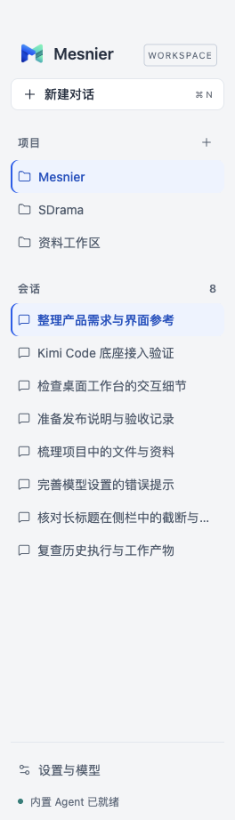
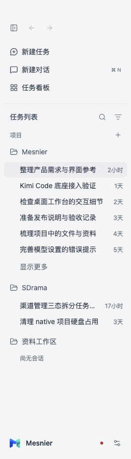
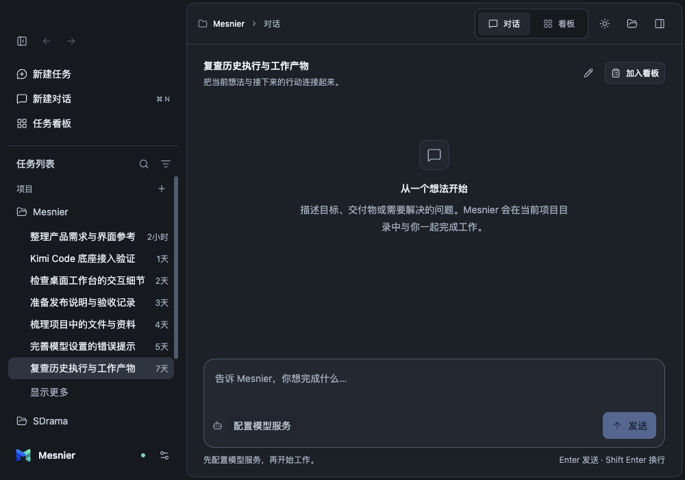

# ZCode侧栏结构对齐与0.1.3安装验收

0.1.2只对齐了通用视觉token，仍保留旧的平铺导航。用户提供ZCode实际侧栏截图后，本轮重新按对应源码校准结构，并将修正打包为0.1.3替换本机应用。

## 参考与结果

参考基线仍为ZCode `3c5b227649371507ddc4eb46ac5133afe6db1cab`。本轮实际核对DesktopTopOverlay、NewTaskButtonGroup、ProjectSidebarNavigation、ProjectSidebarListHeader、ProjectNodeContent和WorkspaceSidebarFooter；规则已写入 [DESIGN.md](../../DESIGN.md#侧栏结构与参考对照)。

| 参考区域 | 本轮结果 |
| --- | --- |
| 顶部工具栏 | 收起、后退、前进；没有顶部大品牌标题 |
| 操作行 | 32px无边框透明行，映射已有新建任务、新建对话、任务看板；Cmd/Ctrl+N仍对应新建对话 |
| 列表标题 | 任务列表、搜索与项目/最近更新切换 |
| 项目与任务层级 | 文件夹父行、32px缩进的会话、14px标题和12px相对时间；单一滚动区域 |
| 选中与长列表 | 中性背景，无蓝色竖线；默认6条、显示更多，当前会话在分页之外仍可见 |
| 底部区域 | 固定品牌、本地运行状态与设置；没有虚构用户账户、手机连接或未接入功能 |

没有新增自动化或插件市场能力。搜索、展开、导航和折叠只影响显示与选择，不复制任务或发起执行。

同一组隔离历史记录下的修改前后截图：

| 0.1.2 | 0.1.3 |
| --- | --- |
|  |  |

## 版本与实际检查

基准`ef2a2aa0eb805a79f3e6cad52b505611e66e241f`加当前未提交工作区；本轮新增Sidebar、navigation、侧栏测试及相关规范和样式，保留前几轮修改。源码、实际app.asar、安装包与截图哈希见 [摘要](sidebar-2026-10-23/summary.json)。没有创建提交、PR或远程发行。

- `npm run typecheck`、`npm run check:design`、静态反例、`git diff --check`通过；9份renderer文件和22组主题文字对比度通过。
- `node --test tests/ui/sidebar.test.mjs`通过：跨项目前后导航与草稿、前进分支截断、搜索越过分页、项目展开、折叠焦点/宽度/偏好及重启后选中项可见。历史数据明确为测试夹具，不能当作Agent执行证据。
- `node --test tests/ui/electron-acceptance.test.mjs`的17项场景通过：真实Electron、宿主和内置运行时，使用受控模型服务执行工具、授权、取消、恢复和任务验收。
- `npm run package`完成DMG与ZIP，签名前23,639份运行时文件核对一致；暂存和实际安装对象均通过`codesign --verify --deep --strict`。
- 指定`MESNIER_INSTALLED_APP=/Applications/Mesnier.app`重跑侧栏专项通过5组检查，确认`isPackaged=true`、版本0.1.3及实际安装路径；实际包的app.asar与构建一致。
- 在原数据目录下正常启动，原项目、会话、任务、模型、消息和执行记录内容指纹一致，加密凭据文件字节未变；实际原生窗口显示新侧栏与Agent就绪，并已置于前台。

## 隔离、安装与复盘

源码测试证据在`.evidence/sidebar-final/`及`.evidence/sidebar-full-verified/`。安装包、收据、安装版专项证据和备份在`/Users/liujialin/Documents/Codex/2026-10-23/Mesnier-0.1.3/`；旧版为`backup/Mesnier-0.1.2.app`。所有测试使用独立MESNIER_HOME及临时工作目录，未在真实项目运行任务；只关闭本任务测试进程及用户授权更新的旧应用。

初次侧栏测试的历史分支断言早于React状态提交，补充等待真实选中项和按钮状态后通过；完整套件的旧模糊搜索定位同时命中了新侧栏按钮与看板输入框，改用精确textbox角色后重跑通过。失败日志保留，没有将失败记为通过。

新增 [LES-005](../../LESSONS.md#les-005参考界面必须逐区域核对结构不能用token和功能测试替代)：上次功能测试与通用token检查没有覆盖参考界面相似性。本轮补充结构映射和实际截图检查，既有功能回归与视觉相似性分别验收。

本轮没有重测真实外部模型推理、其他平台、Gatekeeper或Apple公证；本机临时签名范围不变。仍无自动CI门禁。回退可退出应用后恢复备份包，无数据迁移。
