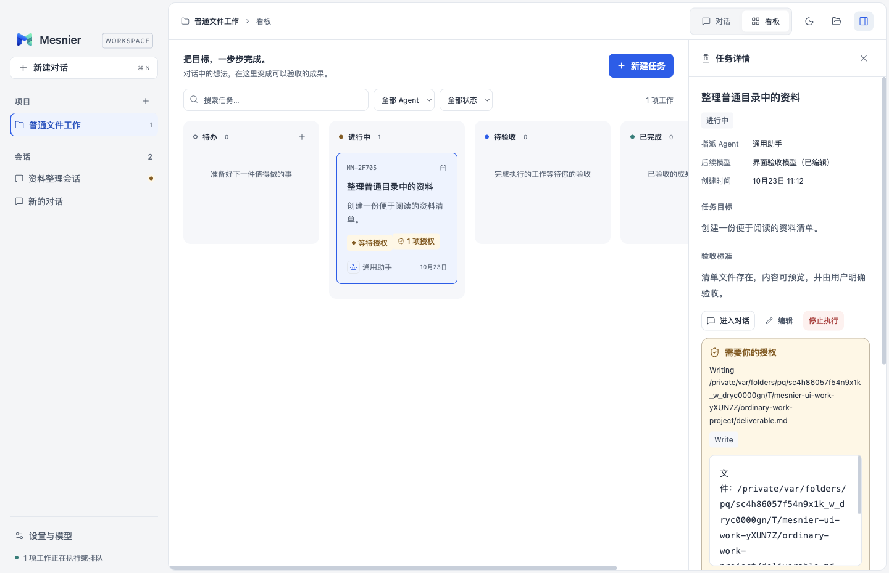
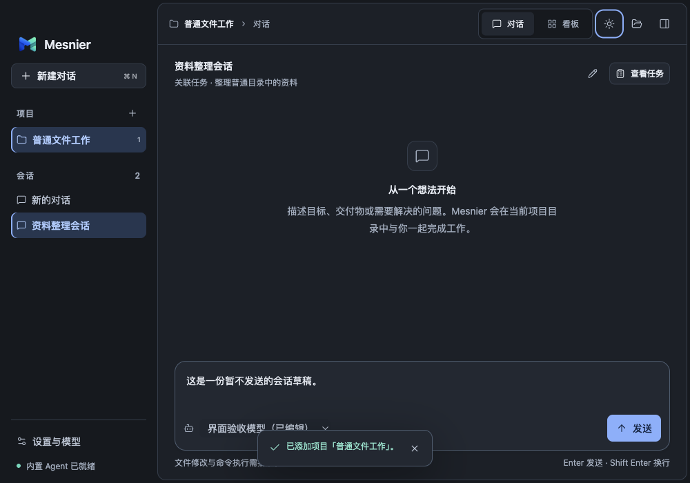
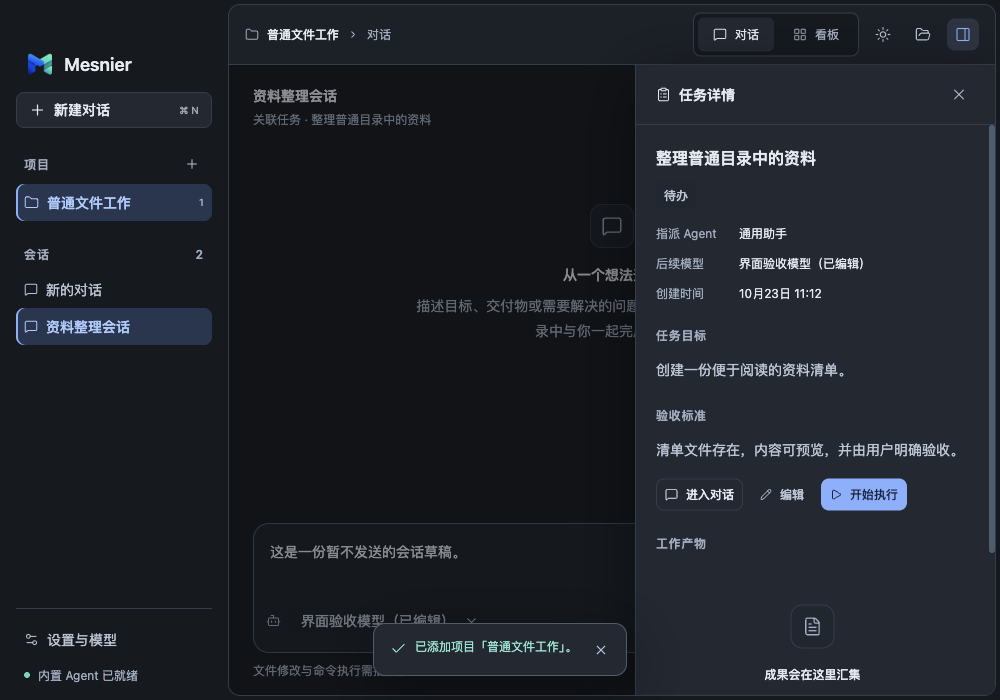
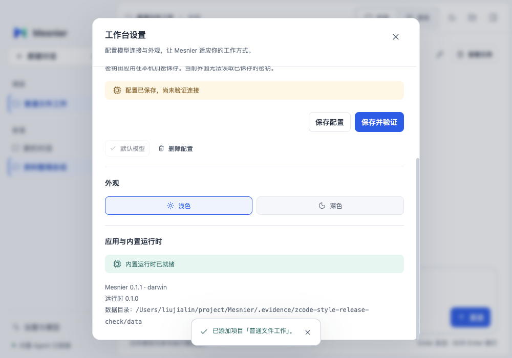

# 桌面设计规范与 ZCode 风格调整验收

本文记录源码阶段；后续0.1.2打包与本机替换结果见 [安装记录](release-0.1.2.md)。

本轮先建立 [DESIGN.md](../../DESIGN.md)，再将 renderer 调整为 Logo 蓝青配色、14px字号体系及独立工作面板。协作约定、贡献指南和 PR 模板要求后续 UI 工作先读取规范；`check:design` 捕获任意字号、主题区外颜色和已列明的文字对比度问题。没有配置自动 CI 门禁。

## 范围与版本

- 基准提交：`ef2a2aa0eb805a79f3e6cad52b505611e66e241f`，加本轮未提交工作区修改。修改前工作区干净；本次未创建提交或 PR。
- 运行对象：Node24.15.0、Electron41.0.3、当前 macOS arm64；应用版本号仍为0.1.1，没有制作新发行包。
- 参考：本地 ZCode `3c5b227649371507ddc4eb46ac5133afe6db1cab`，具体源码入口与采用边界见 DESIGN.md。没有复制 ZCode 组件代码、素材或引入其依赖。
- 最终源码与构建哈希、测试源版本、17项场景结果见 [验证摘要](ui-design-2026-10-23/summary.json)。文档后续完善不影响该应用构建；不能把结果表述为干净提交或已安装版本的验收。

## 行为与设计核对

| 入口与条件 | 修改前 → 修改后 | 实现与证据 |
| --- | --- | --- |
| 各工作台入口 | 灰绿配色、散落的9～13px字号 → 中性表面、Logo蓝青语义配色、14px基准及派生字号 | styles.css；深浅主题截图、字号断言、18组颜色配对 |
| 窄窗口打开详情 | 详情持续占据列宽 → 工作区不足800px时覆盖呈现，底层不可误操作 | App中的ResizeObserver、inert；Inspector焦点与Escape关闭；最小窗口场景 |
| 详情返回对话或放大窗口 | 窄窗口显式进入对话关闭覆盖层；放大后自动恢复并排 | 保留同一会话/任务/草稿，不触发新执行；实际按钮与几何断言 |
| 滚动长设置表单 | 标题可能滚出可视区 → 固定标题贴合弹窗上沿，关闭入口可访问 | 弹窗内部滚动、标题几何位置与长路径无水平溢出断言 |
| 后续开发 | 缺少统一UI规则入口 → DESIGN.md + 协作/贡献/PR引用 + 静态检查 | 人工视觉复核仍是必要步骤，静态检查不代替真实窗口 |

不改变模型协议、任务生命周期、数据格式或权限规则。覆盖层不声明为模态弹窗，侧栏和顶部导航仍可操作；被遮住的主内容使用inert。既有编辑等弹窗的焦点约束继续由Modal管理。

## 实际检查

| 检查 | 结果 |
| --- | --- |
| `npm run typecheck` | 通过；最终TSX内容与检查对象一致 |
| `npm run check:design` | 8份renderer文件通过；18组文字/背景配对达到4.5:1 |
| `node scripts/check-design.mjs --self-test` | 合法token通过；违规字号、颜色、font简写及低对比度反例被识别 |
| `npm run build:app`、`npm run build:runtime` | 通过；构建独立Node24运行时 |
| `MESNIER_UI_EVIDENCE=.evidence/zcode-style-release-check node --test tests/ui/electron-acceptance.test.mjs` | 17个子场景通过，Node测试报告含父测试共18项；无pageerror |
| 真实窗口与截图 | 1440×930和1000×700、深浅主题、欢迎/Chat/Board/Settings、详情覆盖及关闭、设置长内容、工具授权/失败/产物均有证据 |
| OpenSpec | 本次变更严格验证通过，已归档并同步desktop-visual-system规格；全量检查被已有空目录`adopt-kimi-agent-foundation/verification/`触发的缺delta错误影响，未修改该目录。正式归档副本和既有两份能力规格未改动 |
| Git与文档 | 差异空白检查及新增文档相对链接检查通过；完整修改范围已自查 |

完整界面套件使用真实Electron、宿主和内置Kimi运行时，以及仅监听本机回环的受控模型服务。它实际执行文件工具、授权允许/拒绝、取消、重试、会话恢复、Git Coding任务与验收，但不证明第三方真实模型推理兼容性。原生文件夹选择器、Finder、公证、安装包和Windows/Linux本轮未验证。

## 隔离与证据

最终证据在本任务`.evidence/zcode-style-release-check/`：测试复制构建并核对哈希，使用独立MESNIER_HOME、普通临时工作目录与隔离Git仓库；没有使用真实`~/.mesnier`或用户模型凭据。测试仅关闭本次Electron、派生进程及本地服务，保留隔离数据和日志供复核。受控复制产物测试按原有脚本保护并恢复剪贴板。

代表截图（均为隔离测试数据）：

| 修改前 | 修改后 |
| --- | --- |
|  |  |

## 复盘与限制

核对范围为上述基准后的renderer、规范文档、静态检查和UI测试差异。用户补充“先制定规范”属于正常需求细化，不视为故障。候选版实际截图暴露设置标题滚动裁切与固定标题上方露出正文的问题；初始仅断言标题在弹窗内不足以捕获后者，已增加“贴合上沿”断言并通过最终同一套件。候选色板的弱文字对比度4.39:1被检查捕获，已调整到达标，并加入规则检查。经验补充至LES-004，不增加同日独立发现次数。

AI辅助范围为源码研究、规范编写、样式和测试实现；执行者复核真实截图、DOM位置、完整差异和日志，未声称用户已经人工验收。安装包未更新；恢复本轮renderer文件可回退界面，无数据迁移。OpenSpec全量目录告警需由该残留目录的所有者后续处理，本次局部规格及功能验证不受影响。
