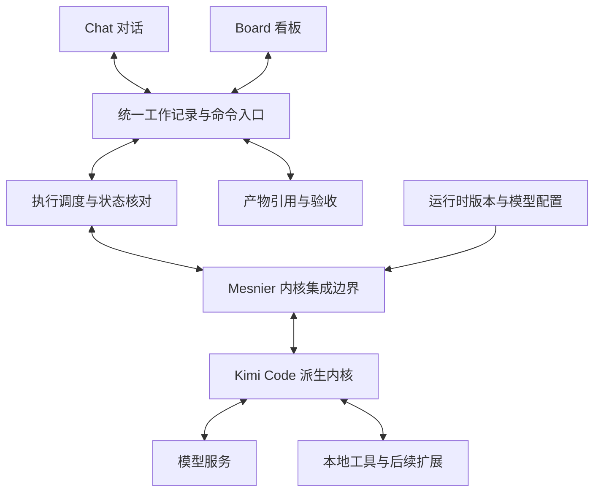

## Context

变更动机和范围见 [提案](proposal.md)。当前只有产品与协作文档，没有应用工程、历史业务数据或需要迁移的已交付规格。本设计确定底座来源、产品与内核边界、工作记录和首个闭环的验收方向；2026-10-22 按用户成品目标确定下述工程方案，后续以实际构建和运行证据校验。

### 本地参考快照

2026-10-22 只读检查了以下本地仓库；检查时三者工作区均无未提交改动。提交用于定位本次设计依据，不等于已选为最终集成版本，也不代表运行验证通过。

| 项目 | 本地研究目录 | 本次读取的完整提交 SHA | 采用范围 |
| --- | --- | --- | --- |
| Kimi Code | `/Users/liujialin/project/kimi-code` | `44cdf8f4039e2ff20d3fe8a4e7868bd90fd786e1` | 新版 TypeScript Agent 底座、SDK 接入和会话能力 |
| ZCode | `/Users/liujialin/project/ZCode` | `3c5b227649371507ddc4eb46ac5133afe6db1cab` | 工作台功能、会话与工具交互、产物体验 |
| Multica | `/Users/liujialin/project/multica` | `51932977d3ff86c74fa2fae5d15115e201bcd9c1` | 看板卡片、指派、状态组织和执行历史 |

可复查入口：

- Kimi Code：[SDK 包配置](https://github.com/MoonshotAI/kimi-code/blob/44cdf8f4039e2ff20d3fe8a4e7868bd90fd786e1/packages/node-sdk/package.json)、[VS Code 宿主接入](https://github.com/MoonshotAI/kimi-code/blob/44cdf8f4039e2ff20d3fe8a4e7868bd90fd786e1/apps/vscode/src/runtime/kimi-runtime.ts)、[MIT 许可证](https://github.com/MoonshotAI/kimi-code/blob/44cdf8f4039e2ff20d3fe8a4e7868bd90fd786e1/LICENSE)。SDK 已有宿主调用实例，但包标记为内部包并依赖多个 workspace 包，不能假定是稳定的独立发行库。
- ZCode：[进程与分层说明](https://github.com/zai-org/ZCode/blob/3c5b227649371507ddc4eb46ac5133afe6db1cab/docs/architecture/zcode-code-architecture-overview.md)、[消息队列交互](https://github.com/zai-org/ZCode/blob/3c5b227649371507ddc4eb46ac5133afe6db1cab/docs/ui/chat-message-queue.md)、[CLI 能力边界](https://github.com/zai-org/ZCode/blob/3c5b227649371507ddc4eb46ac5133afe6db1cab/apps/zcode-cli/docs/usage/README.md)。参考其统一会话事实、工具状态和输入反馈；公开 Computer Use 为占位实现，不能直接计入 Mesnier 的能力。
- Multica：[看板视图](https://github.com/DuskLin/multica/blob/51932977d3ff86c74fa2fae5d15115e201bcd9c1/packages/views/issues/components/board-view.tsx)、[卡片](https://github.com/DuskLin/multica/blob/51932977d3ff86c74fa2fae5d15115e201bcd9c1/packages/views/issues/components/board-card.tsx)、[任务与运行说明](https://github.com/DuskLin/multica/blob/51932977d3ff86c74fa2fae5d15115e201bcd9c1/apps/docs/content/docs/tasks.zh.mdx)。参考状态分列、卡片详情和任务可含多次运行的区分，不照搬其服务器与第三方 CLI 调度架构。本地提交来自用户 fork，快照链接使用包含该提交的 `DuskLin/multica`，项目设计来源仍为 Multica。

这些绝对路径仅用于本地研究；未来构建必须使用明确纳入工程且锁定版本的源码和依赖，不依赖这些目录仍然存在。

## Goals / Non-Goals

**Goals:**

- 在保留上游可构建结构与来源记录的基础上维护 Kimi Code 派生版本，将 Mesnier 差异集中在集成边界、工具扩展和必要内核补丁。
- 让产品层拥有任务目标、指派、验收和交付物关系，让内核拥有原生会话与工具执行；两者通过明确身份和事件关联。
- 在应用管理的运行时和独立数据目录上验证一个 Work 文件任务与一个 Coding 修改任务，覆盖成功与关键失败路径。

**Non-Goals:**

- 不整体 fork ZCode 或 Multica 来充当 Mesnier 产品，不同时维护多种默认执行引擎。
- 不为首版加入参考项目完整插件市场、远端服务、账号体系或订阅权益。
- 不凭上游文档宣称全部模型、文件格式和操作系统已兼容，不把工作目录隔离等同于操作系统沙箱。

## Decisions

### 1. 维护 Kimi Code 派生源码，通过集成边界接入

采用新版 `MoonshotAI/kimi-code` TypeScript 源码，保留上游提交和依赖关系后进行二开。优先通过 SDK／会话接口封装 Mesnier 的执行入口，不把上游内部类型和目录直接散布到各个界面组件。接入层至少覆盖会话建立与恢复、提交输入、事件订阅、权限回应、取消、能力查询和运行信息。

上游更新与 Mesnier 产品发布分别记录版本。业务功能优先使用配置、MCP、Skills 和专用工具扩展；需要修改循环、上下文或权限机制时，保留独立补丁及对应回归证据。

备选方案：从零实现工具循环会扩大内核维护范围；只调用用户已有 CLI 会保留安装和版本不受控的问题；整体继承 ZCode 会带入不同的产品边界。三者均不作为当前默认路线。源码采用仓内 `vendor/kimi` 受控纳入：node-sdk、agent-core-v2、klient、oauth、product、kosong、minidb、tree-sitter-bash 的必要源码与资源；锁定上表 Kimi SHA，保留 MIT 许可和文件哈希。只为显式隔离 home 增加必要透传补丁；构建适配与品牌封装放在 `packages/runtime`。

### 2. 应用管理执行宿主，界面只消费工作状态

桌面采用 Electron + React + TypeScript + Vite，依赖以 npm workspace 和锁文件固定。主进程持有产品状态、凭据和调度；preload 只暴露类型化 Bridge；renderer 开启 sandbox/contextIsolation 并禁止 Node 集成。运行时使用随包分发的 Node 24.15 独立子进程，以 JSONL RPC 通信，避免 Electron 与 node-pty 原生 ABI 冲突：

运行时与 UI 的连接丢失不直接代表任务已结束。UI 发出操作请求、显示处理中状态，再依据执行确认更新事实；界面不自行推演工具成功或通过重新发送任务来恢复画面。

JSONL 使用请求 id 与 runId；stdout 仅协议，stderr 仅脱敏日志。运行时方法为 info/run/approve/cancel/shutdown，流式事件包含唯一 id、runId、kind、payload、时间。模型凭据与工具执行不放在呈现层。首版先采用保守的串行队列，避免多个写任务同时操作同一目录；多任务并发和 worktree 调度在后续变更中扩展。

### 3. 产品任务与内核会话分别保存并建立关联

| 对象 | 归属与关系 |
| --- | --- |
| 项目 | Mesnier 保存工作目录与产品设置；Git 关联可选 |
| 会话 | Mesnier 保存产品会话身份、展示记录与内核会话引用；内核保存自己的原生上下文 |
| 任务 | 保存目标、Agent 指派、交付要求和验收状态；首版一个任务关联一个主要会话，对话可以暂不关联任务 |
| 执行 | 一次用户提交或重试产生一条记录；同一任务可有多次执行，记录其会话、配置快照、内核版本与事件 |
| 产物 | 记录文件引用、类型、所属执行和可访问状态；不假定外部文件一直不变或存在 |

将对话关联为任务只增加关系，不新建内核会话、不重发输入；重复关联返回已有任务。Chat 与 Board 订阅同一份产品记录。事件以执行身份和可去重的事件标识关联，重复订阅或重连不能增加一次执行或重复处理权限响应。

修改任务指派或默认模型只影响后续执行；历史执行保留启动快照，凭据以引用表达。内核上下文压缩、模型更换或会话不兼容时，明确说明恢复方式，不承诺跨引擎原生状态迁移。

备选方案是用 CLI 会话或进程状态直接代表任务状态。这会混淆多次执行、用户验收和产物归属，因此不采用。

### 4. 控制操作、任务状态与执行状态分开

任务主流程为待办、进行中、待验收和已完成；失败、阻塞、取消和待核对属于需要显式呈现的执行事实，不能只用卡片所在列代替。

| 场景 | 规划处理 |
| --- | --- |
| 提交与排队 | 创建一次执行记录；同一请求重复到达只关联原记录；实际执行开始前不显示正在调用工具 |
| 权限请求 | 以执行和请求身份呈现；拒绝不执行该次操作；已失效或已处理的响应不能再次放行 |
| 追加指令 | 按已验证能力路由；尚不支持时保留输入并提示后续提交，不能重新启动原任务 |
| 取消 | 请求后先显示正在停止；确认停止才记录取消；超时则待核对，已经发生的文件和外部副作用不自动回滚 |
| 失败与重试 | 保留错误及产物；首版由用户显式重试并创建新执行，避免盲目重放副作用 |
| 执行成功 | 进入待验收；只有明确验收通过才成为已完成任务 |
| 拖拽卡片 | 只处理允许的任务状态变化；不隐式发起执行、取消或验收，冲突时解释并恢复可信状态 |
| 应用重启 | 读取历史并核对原执行；能够连接则恢复观察，失联或不兼容时保留记录并提示，不自动重跑 |

首版桌面的权限策略固定为手动确认：通过已有配置层 `permission.rules` 对 `Write`、`Edit`、`Bash` 设置 `ask`，每次批准仅覆盖当前操作；读取沿用内核默认策略。上游 `manual` 仍会自动允许 Git 工作树内的 Write/Edit，因此不能仅靠该模式名称承诺按次授权。验证必须分别覆盖真正无 Git 祖先的普通目录、显式 Git 仓库，以及恢复的会话；不修改内核权限循环。

工具的 Bash/PTY 可能建立独立进程组，宿主依据内核进程观察事件跟踪其 PID/PGID 与出生时间；终态及退出前清理并确认自身工具组停止，不能只判断 worker leader。无法确认归属或退出时停止后续调度并显示待核对，不终止其他应用进程。

这组规则借鉴两个参考项目的状态呈现方式，但以 Mesnier 的验收语义为准，不继承其自动派发、自动重试或自动完成策略。

### 5. 先验证基础文件交付，再扩展 Work 工具

首个闭环覆盖本地文本文件、文件引用和变更摘要。Chat 参考 ZCode 呈现回复、工具过程、权限请求、输入状态与结果；Board 参考 Multica 的状态列、Agent 指派、筛选、卡片摘要与详情，不要求首版实现全部自定义属性或工作流设计器。

文档、表格、演示文稿、浏览器等按独立工具接入，分别核对依赖、许可、模型能力与产物预览；尚未实现时不提供会假装成功的入口。复制任何参考代码前，单独检查来源和许可，不能因功能相似就混入它的私有服务约定。

### 6. 独立数据与可复现维护

Mesnier 默认以 `~/.mesnier` 为唯一应用数据根，开发和测试以显式 `MESNIER_HOME` 隔离。产品状态为 `state.json`（schemaVersion=1），临时文件写入后原子重命名并保留上一版备份；未知新版本拒绝写入。会话/缓存/日志置于该根下，harness 显式 home/config/osHomeDir/skillDirs 防止自动扫描用户其他 Agent 配置。模型支持配置 OpenAI Chat、OpenAI Responses、Anthropic 协议，实际兼容服务须逐个验证；凭据由 Electron safeStorage 加密保存在私有文件中，不进入 snapshot/运行记录。加密不可用时不静默明文落盘。核对内核实际解析的 home/config 路径和环境变量，不靠临时工作目录假定账号已隔离；不自动导入用户既有 Kimi 数据。

保留 Kimi Code 的 MIT 许可、版权声明、上游 SHA 与派生补丁清单。应用自有代码许可另行确定。模型认证与源码授权分别处理，先验证配置的模型服务，不承诺官方 OAuth、订阅、市场或云端功能随源码复用自动可用。

升级前验证旧会话读取和控制接口，在无法兼容时保留原始数据并说明恢复路径；不自动用旧版本回读已迁移的数据。正式迁移与恢复步骤需随实际存储方案落地。

## Risks / Trade-offs

- **SDK 与内部接口仍在演进** → 锁定上游提交，在 Mesnier 集成边界吸收差异，为会话、事件、权限和取消建立契约检查。
- **拥有默认内核增加维护责任** → 保留可构建的上游结构，集中记录补丁；升级和产品功能分别审查，避免无关重写。
- **模型兼容不等于执行质量一致** → 对每个声称支持的模型验证工具调用、错误与上下文行为；比较底座效果时使用相同模型与任务。
- **丰富工具与官方产品展示可能不一致** → 基础文件闭环先行，逐个验证插件和外部资源，区分源码入口与实际可用能力。
- **产品状态与内核事件失配** → 明确唯一关联、事件去重、取消确认和重启核对；不以进程退出或界面提示代替验收。
- **跨平台打包和系统依赖不同** → 对 macOS、Windows、Linux 分别记录验证状态；没有实际运行证据的平台只能标为规划目标。

## Migration Plan

首版不存在用户历史应用数据。构建产物为 Mesnier.app、macOS DMG/ZIP，携带 renderer 静态资源、Node 二进制、内核 bundle 与原生依赖，不依赖开发服务器。先安装到隔离目录实测，再按用户授权安装可用应用；未完成全部验收前不归档。应用退出终止自身运行时；正常退出若已收到取消确认则保留 cancelled，崩溃或强制退出后仍未确认终态的原活动执行在重启时标记 interrupted。保留日志、产物及原生会话；继续会话由用户提交新输入触发，不自动重放。

后续按 [任务清单](tasks.md) 推进：先记录工程选型与底座验证，再接入运行时、模型配置、统一工作记录和两个视图，最后完成真实运行与目标平台验证。第一阶段未解决的工程选择必须在依赖它们的实现开始前回写设计；如果验证要求改变规格或扩大范围，先更新变更。

未来首次发行前，确认未安装独立 Agent CLI 的测试环境能够执行 Work 与 Coding 样例。升级机制涉及的备份、兼容检查及恢复必须覆盖实际数据格式；不承诺仅回退二进制即可恢复全部历史状态。

## 验证与职责

主执行者维护 OpenSpec、共享协议、Electron 宿主、状态、集成与打包。运行时、renderer、独立验收分别在专属 worktree 开发，提交后交叉审查再集成；每个可验证阶段按最新 SHA 合入 main，遵守仓库规则。

真实 harness 使用本地可控 HTTP 模型服务验证协议、工具与失败链路；这不代表真实模型完成任务。真实模型测试需要专用凭据或明确授权的服务，当前未配置，保持为独立未完成项，期间继续完成不依赖该外部条件的工作。产物和证据记录实际构建版本、模型类别及未覆盖项。

运行时依赖的工具在 macOS 实机核对；Windows、Linux 留在后续路线图，不宣称已支持。发行签名与公证取决于开发者签名资源，无签名时如实说明安装方式，不伪造公证结果。
