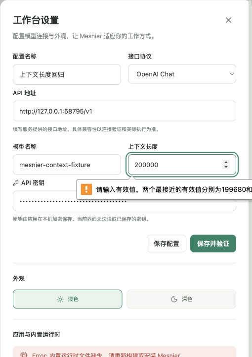
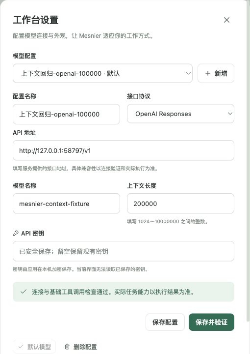

# 2026-10-23 上下文长度界面回归

同一份真实 Electron 回归在旧构建中退出 **1**，在修复构建和实际 `0.1.1` 打包应用中均退出 **0**。问题由实际填写 `200000` 并点击「保存并验证」复现：浏览器报告 `stepMismatch=true`，模型记录和本地模型服务请求都仍为零。

修复后完成 23 项行为核对，覆盖 OpenAI Chat 与 OpenAI Responses 两个协议。`200000`、`100000`、`1024` 和 `10000000` 都分别经「保存配置」与「保存并验证」进入实际宿主，`state.json` 保留精确整数，没有取整或改为 1024 的倍数。「保存并验证」共向本机服务发送 8 次真实工具能力探测；「保存配置」不额外发送请求。

两协议下的 `100000.5`、`1023` 和 `10000001` 都禁用两个保存按钮。实际点击按钮位置及按回车后，持久化内容不变，服务没有收到额外请求。重新打开设置仍显示精确的 `100000`。

## 验证对象与运行

- 应用源码基准：`681d755cb1f25e3296cffd048ee090fec41a6455`。
- 修复对象：基准加未提交 `Settings.tsx` 及版本更新后的 `package.json`、`package-lock.json`；对应源文件与全部构建文件哈希见 [验证摘要](evidence/context-length-summary.json)。不能把结果表述为基准干净提交的结果。
- 测试源 SHA-256：`6dc137402f1d68206e83b4fdd881fb3e4c9fc9dd58296785667195a749adefdc`。
- 旧渲染脚本：`index-TwdAAzQ0.js`，SHA-256 `e680806cd1dd2096a58621a14a5e68747366d34422f8a547a228adf4310437f0`。
- 新渲染脚本：`index-7XrFoU6x.js`，SHA-256 `b3760690ba1e5b7970486bbacafda9924712d46f9e132cff088a58a2cd93ddbb`。
- 环境：macOS arm64、Electron 41.0.3、测试驱动 Node v22.22.0；开发构建聚焦回归约 6.2 秒，真实打包应用约 16.5 秒。

在完成 `npm run build:app` 的工程根目录执行：

```bash
node --test tests/ui/context-length.test.mjs
```

额外设置 `MESNIER_INSTALLED_APP=/绝对路径/release/mac-arm64/Mesnier.app` 可直接验证实际打包应用；本轮已执行，核对 `isPackaged=true`、应用版本和真实可执行路径，且 `app.asar` 与可执行文件哈希前后不变。打包模式不复制运行时或改写安装内容。

可用 `MESNIER_APP_ROOT` 指定其他已构建工程，`MESNIER_UI_EVIDENCE` 指定本轮独立证据目录，`MESNIER_ELECTRON_PATH` 指定测试 Electron。旧版反例将 `MESNIER_APP_ROOT` 指向事先冻结的旧构建；两次使用完全相同的测试文件，不能通过修改断言制造失败。

开发模式先复制宿主与界面构建再运行，报告记录完整构建哈希；打包模式直接运行指定的真实 `.app`。所有业务变化由真实按钮、输入框和回车触发，桥接快照与测试目录里的 `state.json` 只读核对。测试创建回环 HTTP 服务，只处理两个协议的工具能力探测，不连接用户截图中的地址，不读取用户密钥。只关闭本次 Electron 与本地服务，未操作用户当前应用窗口。

| 修复前：实际点击触发步长错误 | 修复后：Responses 的 200000 连接通过 |
| --- | --- |
|  |  |

## 边界与复盘

本轮聚焦模型设置与实际宿主持久化，没有运行 Agent 任务；开发构建副本未携带 Agent 运行时，因此旧版设置底部的运行时缺失提示属于该测试的明确边界，与步长失败无关。打包应用使用自身资源完成同一设置回归。没有重新执行完整 17 场景套件，也不把本轮视为打包应用的完整任务闭环或真实外部模型验收。

此前界面测试使用默认 `32768`，没有覆盖合法但非 1024 倍数的常见上下文长度，遗漏了原生表单约束与宿主整数契约不一致的问题。本轮增加实际输入与双入口回归，并用旧构建证明测试能捕获该缺陷；同类经验由主执行者合并到 `LESSONS.md`，不把同日问题重复计为独立发现日期。
