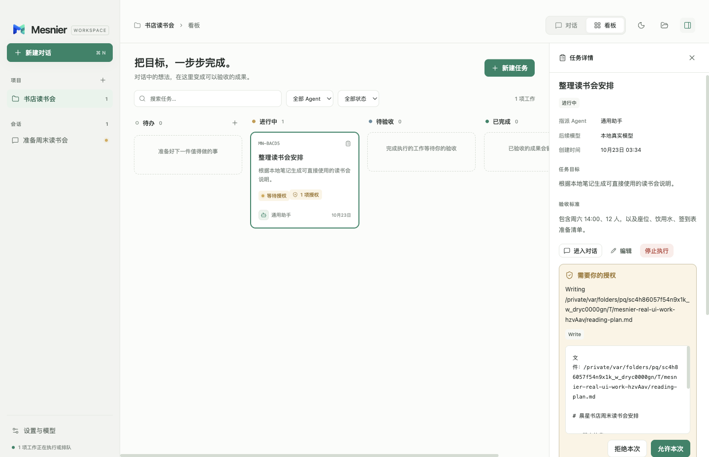
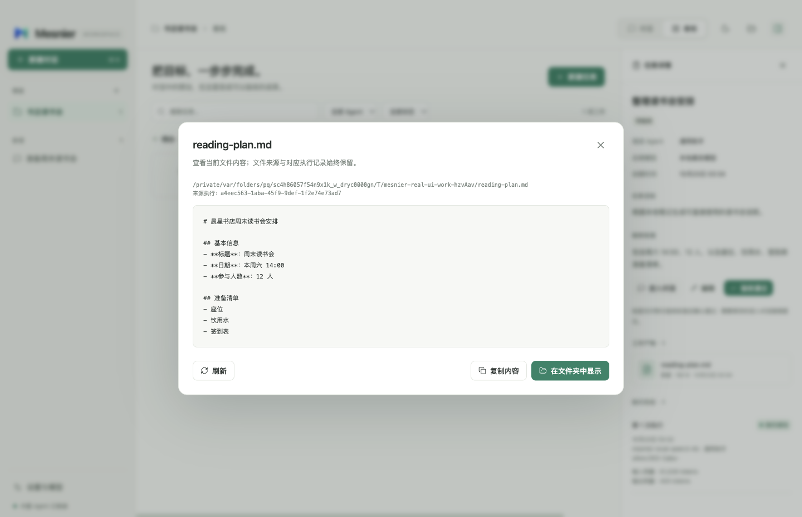
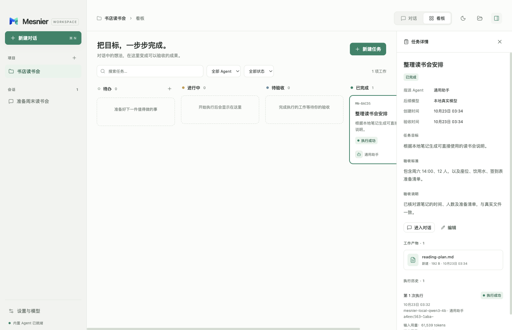

# 2026-10-23 已安装应用与真实模型界面验收

直接启动 `/Applications/Mesnier.app`，使用真实本地 Qwen3-4B 模型完成读取笔记、授权写入、实际产物预览、看板验收及重启恢复。**整轮通过，进程退出 0，耗时约 129 秒**。测试没有使用可控模型响应。

测试入口为 [packaged-real-model.test.mjs](packaged-real-model.test.mjs)，运行方法见 [README](README.md#已安装应用与真实本地模型)，脱敏结果见 [安装版真实模型摘要](evidence/packaged-real-summary.json)。完整报告、全部截图及逐文件资源清单保留在执行者工作区 `.evidence/ui/packaged-real-20261023/`。

## 验证对象

- 安装应用：`/Applications/Mesnier.app`，版本 `0.1.0`，实际 `isPackaged=true`；可执行文件与 Resources 路径都核对为该安装目录。
- `app.asar` SHA-256：`2717594effe5d5f98be5e23e66c21d183f75d33f16576293b937b899dfb02711`。
- 完整 Resources 目录摘要：`c82df18f7c53f8edc043f35e1d95108a50dfb06162dbc881ef11eca25dcc1fb6`，覆盖 23,645 个文件或符号链接，验收前后保持一致。摘要包含随包运行时和动态模块。
- 测试源码 SHA-256：`31477f2ba99b8c6674c4fb7924ad9a10f8964c725f2c326db0ee494771e88102`。
- 环境：Darwin 24.6.0、arm64、Electron 41.0.3；驱动使用 Node v22.22.0。模型服务地址为本机回环地址，模型名称为 `mesnier-local-qwen3-4b`。
- `/usr/bin/codesign --verify --deep --strict` 退出 0。该检查证明安装文件通过当前签名完整性校验，不代表已完成 Apple Developer ID 签名或公证。

应用进程的 `PATH` 仅包含 `/usr/bin:/bin:/usr/sbin:/sbin`；逐项确认这些目录不存在 `kimi`、`kimi-code`、`codex`、`claude` 或 `opencode` 可执行文件。内置 Agent 仍就绪并完成真实任务，证明该执行不依赖从搜索路径启动已有独立 Agent CLI；不能据此声称机器上从未安装这些程序。

本轮通过 Playwright 的 Electron 启动接口运行真实已安装应用。通过 LaunchServices 从系统打开应用的验收由主执行者另行记录，两者不混称。

## 实际行为

通过界面配置模型并完成连接验证，在独立的非 Git 工作目录中创建项目与会话。该目录的 `git rev-parse --is-inside-work-tree` 退出 128；应用配置写入本轮隔离目录。

源笔记包含晨星书店、本周六 14:00、12 人和座位／饮用水／签到表。模型实际调用 `Read` 后提出 `Write` 权限请求。验收只允许目标与指定 `reading-plan.md` 精确匹配的写入；期间把对话加入看板，保持同一执行身份，没有额外启动执行。

批准后执行成功，实际 Markdown 文件包含源笔记的时间、人数与三项准备内容。产物预览与磁盘读取内容逐字一致；文件大小为 192 字节，SHA-256 为 `7ef15e8b5ce9b302ec419b3c0dbfb9404eda65345f5dda909bcae911947235e0`。任务先进入待验收，界面明确确认后才变为已完成。

关闭并重启同一安装应用后，原会话、任务和执行仍存在。执行仍只有一次，事件数量不增加，产物内容哈希和修改时间不变，证明重启没有自动重放或重写产物。没有捕获页面运行错误。

## 复盘与边界

本阶段补齐的是已安装应用、真实模型和界面操作共同经过的执行链路；发现的源事实、审批范围与产物均由实际运行核对，没有新增确认的产品缺陷或重复返工教训。原有受控界面回归、隔离配置、目录类型及完整运行时版本绑定规则已继续执行。

没有交互验证原生目录选择器、Finder 窗口，也没有验证其他操作系统、全部第三方模型或公证分发。配置通过实际输入框填入工作目录，不能把这一步描述为完成原生选择器验收。测试只关闭自己的应用实例，不停止共享模型服务或其他应用实例，不操作剪贴板。
